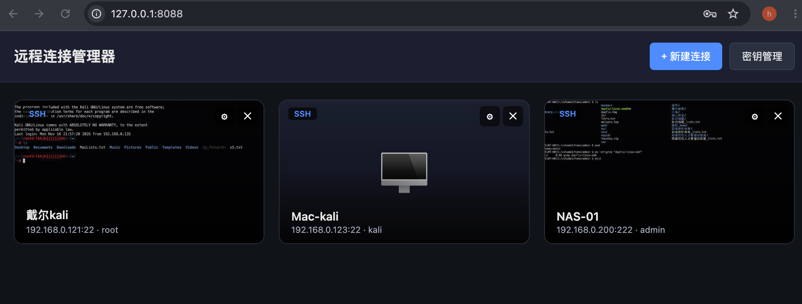

# 远程连接管理器（Remote Connect Manager）

一个自托管的 Web 控制台，把分散的 SSH / VNC / RDP 目标集中登记成卡片，点击卡片即可直接在浏览器里操作远程会话；每个卡片用该连接最后一次的界面截图作为背景，一眼就能看出每台机器当前的状态。



## 项目介绍

日常要维护多台 Kali / Linux / Windows 主机时，配置散落在各个客户端里，每次都要重新翻 IP、端口、密钥。这个项目把「配置登记 + 一键连接 + 界面留影」做成一个页面：

- 后端 Go（Gin + gorilla/websocket），用 `golang.org/x/crypto/ssh` 直连 SSH，用 noVNC 协议代理 VNC，用 Guacamole 协议经 `guacd` 连接 RDP。
- 前端纯静态（xterm.js / noVNC / guacamole-common-js），全部依赖本地化到 `web/vendor/`，通过 `embed.FS` 打进二进制，离线可用。
- 配置与密钥以 JSON 形式落盘到 `data/`，截图存 `data/screenshots/`，直接挂载卷即可迁移备份。

## 功能介绍

### 连接管理

- SSH / VNC / RDP 三种类型统一登记：名称、主机、端口、用户名、分辨率、认证方式。
- 卡片网格展示；有截图时用最后界面图作背景，没有截图时显示类型图标。
- 卡片右上角提供「编辑配置」「删除」；点击卡片打开会话窗口。
- 会话中的连接卡片会高亮并标注「运行中」，用来区分正在使用的连接。

### SSH 会话

- 支持密钥登录与密码登录；密钥登录时可选择密钥库中的任意私钥。
- 自动扫描 `~/.ssh`：`id_rsa`、`id_rsa.pub`、`authorized_keys` 等文件在启动时自动导入密钥库，同名同内容跳过，同名不同内容自动加哈希后缀，避免覆盖。
- 交互式终端（xterm.js + PTY），窗口大小变化会把 `cols/rows` 同步给远端，`vim`、`htop`、`tmux` 都能正常使用。

### 密钥管理

- 密钥列表：名称、来源（哪个 `~/.ssh` 文件）、创建时间、公钥内容。
- 生成新密钥、导入密钥、重新扫描 `~/.ssh`、一键复制公钥。
- 密钥可编辑：改名称、改私钥正文、改公钥；改名会同步更新所有引用该密钥的连接配置，改正文会校验是否是合法私钥。
- 识别加密私钥（带 passphrase）：列表标记「（加密）」，连接时在密码栏填入口令即可。

### VNC / RDP

- VNC 走 WebSocket 裸转发到 noVNC 客户端；服务器需要密码时自动使用配置里保存的密码。
- RDP 由后端完成 Guacamole 握手（`select → args → size/image/video/audio/timezone → connect → ready`），前端只负责渲染与输入，`guacd` 由 compose 里的独立服务提供。

### 会话窗口

- 缩放（`−` / `⟲` / `+`）、全屏（`⛶`）。
- **最小化（`↘`）**：把当前窗口等比例动画缩回该连接卡片的位置，连接**不中断**，卡片标记「运行中」；再点卡片即从卡片位置等比放大恢复原会话。
- **关闭（`✕`）**：先截图并等上传完成，再断开连接，随后自动刷新该卡片的背景图。

### 卡片背景图

- 会话进行中每 2 秒检测一次画面是否变化（降采样指纹比对），有变化时**最短间隔 10 秒**上传一次并替换卡片背景；最小化到后台后仍持续更新。
- 截图统一降采样为 JPEG，服务端只保留每台连接的最新一张，长时间挂着也不会把磁盘写满。

## 特点

- **零客户端**：浏览器打开就能用，不需要在每台设备上装终端 / 远程桌面软件。
- **开箱即用**：启动时自动接管 `~/.ssh` 里的密钥，已有免密登录习惯无需改动。
- **离线可构建**：前端依赖与 Go 依赖都走 `vendor/`，`docker build` 不需要外网。
- **数据即文件**：JSON + 截图文件，备份就是拷 `data/` 目录，没有数据库依赖。
- **会话保活**：最小化只是「收进卡片」，SSH/远程桌面会话在后台继续跑，随时点开继续操作。
- **单二进制 + 内嵌前端**：`go build` 出一个可执行文件，前端资源打包在二进制内。

## 技术栈

| 层 | 技术 |
| --- | --- |
| 后端 | Go 1.21+、Gin、gorilla/websocket |
| SSH | `golang.org/x/crypto/ssh`（密钥/密码认证、PTY、WindowChange） |
| VNC | WebSocket ↔ TCP 裸转发 + noVNC 1.4 |
| RDP | Guacamole 协议隧道 + `guacd` 1.5.5 |
| 前端 | 原生 JS、xterm.js 5.3（含 canvas 渲染器用于截图）、noVNC、guacamole-common-js |
| 存储 | JSON 文件（`data/connections.db`）+ 截图文件（`data/screenshots/`） |
| 部署 | Docker 多阶段构建 + docker compose |

## 目录结构

```
remote-connect-manager/
├── main.go                     # 路由、embed 前端、启动时自动导入 ~/.ssh 密钥
├── internal/
│   ├── config/                 # 连接配置 CRUD（JSON 持久化）
│   ├── keys/                   # 密钥库：扫描、生成、导入、编辑、加载签名器
│   ├── ssh/                    # SSH WebSocket + PTY 透传
│   ├── vnc/                    # VNC WebSocket 裸转发
│   ├── rdp/                    # RDP：guacd 握手与双向透传
│   └── screenshot/             # 截图落盘与旧图清理
├── web/
│   ├── index.html              # 页面结构
│   ├── css/style.css
│   ├── js/app.js               # 卡片、配置弹窗、密钥弹窗、会话与截图逻辑
│   └── vendor/                 # xterm / noVNC / guacamole 本地化依赖
├── data/                       # 运行时数据（配置、截图、密钥），首次启动自动创建
├── vendor/                     # Go 依赖（离线构建）
├── .github/workflows/release.yml  # 推 v* 标签自动编译三平台二进制并发布
├── Dockerfile
├── docker-compose.yml
└── start.sh
```

## 编译

### 本地编译

需要 Go 1.21+。依赖已随仓库提供（`vendor/`），无需联网：

```bash
git clone https://github.com/hktalent/remote-connect-manager.git
cd remote-connect-manager

# 使用 vendor 离线构建
GOFLAGS=-mod=vendor go build -o remote-connect-manager .

# 可选：跑一下
PORT=8080 ./remote-connect-manager
```

> 若想更新依赖，可用 `GOFLAGS=-mod=mod GOPROXY=https://goproxy.cn,direct go mod tidy` 后再 `go mod vendor`。

### 跨平台发布（GitHub Actions）

仓库内置 [.github/workflows/release.yml](.github/workflows/release.yml)：**推送 `v*` 标签即自动编译并发布 Release**，产物是不依赖 Docker 的独立可执行文件。

```bash
git tag v1.0.0
git push origin v1.0.0
```

工作流会并行编译 5 个目标并上传到 Release：

| 平台 | 架构 | 产物 |
| --- | --- | --- |
| Linux | amd64 / arm64 | `remote-connect-manager_<版本>_linux_<arch>.tar.gz` |
| macOS | amd64（Intel）/ arm64（Apple Silicon） | `remote-connect-manager_<版本>_darwin_<arch>.tar.gz` |
| Windows | amd64 | `remote-connect-manager_<版本>_windows_amd64.zip` |

- 编译参数：`CGO_ENABLED=0`（纯静态、无 C 依赖）、`-trimpath`、`-ldflags "-s -w -X main.version=<标签>"`，前端 `web/` 由 `embed.FS` 打包进二进制。
- 也可以在 Actions 页面手动触发（`Release → Run workflow`），填一个版本号即可。
- 需要本地复现某个平台时：

```bash
GOOS=windows GOARCH=amd64 CGO_ENABLED=0 GOFLAGS=-mod=vendor \
  go build -trimpath -ldflags "-s -w -X main.version=v1.0.0" -o rcm.exe .
```

### Docker 构建

```bash
docker build -t remote-connect-manager:latest .
```

多阶段构建：`golang` 镜像里离线编译出静态二进制，再拷进 `debian:bookworm-slim`，镜像内只保留可执行文件、`web/` 与启动脚本。

## 使用

### 1. 用 docker compose 启动（推荐）

```bash
cd remote-connect-manager
docker compose up -d --build
```

启动后访问：<http://localhost:8088>

compose 会拉起两个容器：

- `remote-connect-manager`：主服务，宿主机 `8088` → 容器 `8080`。
- `rcm-guacd`：`guacamole/guacd:1.5.5`，供 RDP 使用。

默认挂载与参数（见 [docker-compose.yml](docker-compose.yml)）：

| 项 | 说明 |
| --- | --- |
| `./data:/app/data` | 配置、密钥、截图持久化到宿主机 |
| `${HOME}/.ssh:/host-ssh:ro` | 只读挂载宿主机 SSH 目录，启动时自动导入私钥 |
| `PORT=8080` | 容器内监听端口 |
| `GUACD_ADDR=guacd:4822` | RDP 使用的 guacd 地址 |
| `host.docker.internal:host-gateway` | 让容器能访问宿主机上的虚拟机 / 端口转发 |

改端口只需改 compose 里的 `"8088:8080"` 左侧，例如 `"9090:8080"`。

### 2. 独立运行（Windows / macOS / Linux，免 Docker）

到 [Releases](https://github.com/hktalent/remote-connect-manager/releases) 下载对应平台的包，解压后在**同一个目录**里运行（配置、密钥、截图默认写在当前目录的 `data/`）：

**macOS / Linux**

```bash
tar -xzf remote-connect-manager_<版本>_<平台>_<架构>.tar.gz
chmod +x remote-connect-manager
./remote-connect-manager              # 默认 :8080
PORT=9090 ./remote-connect-manager    # 换端口
```

> macOS 首次运行若提示「无法验证开发者」，右键 → 打开，或执行 `xattr -d com.apple.quarantine ./remote-connect-manager`。

**Windows**

```powershell
# 解压 zip 后，在解压目录打开 PowerShell
.\remote-connect-manager.exe
# 换端口
$env:PORT=9090; .\remote-connect-manager.exe
```

打开 <http://127.0.0.1:8080> 即可使用。

独立运行的注意事项：

- **数据目录跟随工作目录**：`data/connections.db`、`data/keys/`、`data/screenshots/` 都相对于启动时的当前目录。建议在固定目录里启动（Windows 快捷方式需设置「起始位置」），迁移时拷 `data/` 即可。
- **密钥来源**：会自动扫描 `$HOME/.ssh`（Windows 为 `C:\Users\<你>\.ssh`）；想扫描其它目录用 `SSH_SCAN_DIR` 指定。
- **RDP 依赖 guacd**：SSH / VNC 开箱可用，RDP 需要本机或局域网内有 `guacd`：

```bash
docker run -d --name guacd -p 4822:4822 guacamole/guacd:1.5.5   # 只需这一个容器
GUACD_ADDR=127.0.0.1:4822 ./remote-connect-manager
```

- **生产环境**建议关闭 Gin 调试输出：`GIN_MODE=release ./remote-connect-manager`。
- 版本号来自编译期注入，启动日志第一行会打印（如 `remote-connect-manager v1.0.0`）。

### 3. 配置一条连接

1. 点右上角「+ 新建连接」，选择类型（SSH / VNC / RDP），填主机、端口、用户名。
2. SSH 选「密钥」认证并挑一把密钥；私钥带口令的话在密码栏填口令。VNC / RDP 直接填密码。
3. 保存后点击卡片即可连接。终端里正常操作，窗口大小变化会同步到远端。
4. 想切回卡片视图点 `↘`（会话不中断），想结束会话点 `✕`（关闭后卡片背景自动更新为该会话最后一屏）。

### 4. 密钥

点右上角「密钥管理」：

- 「扫描 ~/.ssh」重新扫描并导入新密钥；
- 「生成新密钥」按名称生成一对新密钥；
- 每个密钥可「复制公钥」（粘到目标机器 `~/.ssh/authorized_keys`）、「编辑」（改名 / 改内容）、「删除」。

密钥文件实际存放在 `data/keys/`，来源目录可通过环境变量 `SSH_SCAN_DIR` 指定（默认依次尝试 `/host-ssh`、`$HOME/.ssh`）。

## 环境变量

| 变量 | 默认值 | 说明 |
| --- | --- | --- |
| `PORT` | `8080` | HTTP 监听端口 |
| `GUACD_ADDR` | `127.0.0.1:4822` | guacd 地址，RDP 使用 |
| `SSH_SCAN_DIR` | `/host-ssh` → `$HOME/.ssh` | 密钥扫描目录 |

## 配置说明

### 数据目录

所有运行时数据都在启动目录的 `data/` 下（Docker 部署时对应容器内 `/app/data`）：

```
data/
├── connections.db        # 连接配置，实际是 JSON 数组（不是 SQLite）
├── keys/                 # 密钥库
│   ├── id_rsa            # 私钥（文件名即密钥名）
│   ├── id_rsa.pub        # 公钥
│   └── .manifest.json    # 密钥来源记录：{ "id_rsa": "/Users/you/.ssh/id_rsa" }
└── screenshots/          # 卡片背景图：<连接ID>_<纳秒时间戳>.jpg|png（每连接只保留最新一张）
```

### 连接配置（`data/connections.db`）

每次请求都会重新读取该文件，因此**直接编辑 JSON 也能生效**（改完刷新页面即可，无需重启）。格式：

```json
[
  {
    "id": "0b6f3c1e-9a2d-4b7c-8f10-3d1a2b3c4d5e",
    "name": "戴尔kali",
    "type": "ssh",
    "host": "192.168.0.121",
    "port": 22,
    "username": "root",
    "auth_type": "key",
    "key_name": "id_ed25519",
    "width": 0,
    "height": 0,
    "screenshot": "/screenshots/0b6f...jpg",
    "created_at": "2026-11-16T13:37:00+08:00",
    "updated_at": "2026-11-16T13:37:00+08:00",
    "last_connect": "2026-11-16T21:56:51+08:00"
  }
]
```

| 字段 | 说明 |
| --- | --- |
| `id` | UUID，新建时自动生成 |
| `name` | 卡片显示名 |
| `type` | `ssh` / `vnc` / `rdp` |
| `host` / `port` | 目标地址；RDP 默认 3389，VNC 5900，SSH 22 |
| `username` | 登录用户（VNC 可留空） |
| `auth_type` | `key` 或 `password`（SSH 生效） |
| `key_name` | 引用 `data/keys/` 下的密钥名；私钥带口令时口令填在 `password` |
| `password` | VNC / RDP 密码，或 SSH 密钥口令 |
| `width` / `height` / `color_depth` / `security` | RDP / VNC 画面参数，缺省由服务端决定 |
| `screenshot` | 卡片背景图地址，由程序自动写入，不要手填 |

> `data/connections.db` 里可能含明文密码，请当作敏感文件保护（Docker 部署时它落在宿主机 `./data`）。

### 密钥文件

- 密钥名必须能通过文件名安全校验（字母、数字、`_`、`-`、`.`），改名会同步更新所有引用它的连接。
- 从 `~/.ssh` 扫描时：能解析的私钥会推导公钥；加密私钥（`-----BEGIN ... ENCRYPTED-----`）也会导入并标记「加密」，连接时用口令解锁；同名不同内容会加 `_<sha256前6位>` 后缀，不会覆盖已有密钥。
- `.pub` 文件、`config`、`known_hosts*`、`authorized_keys*` 会被跳过。

### 端口与运行参数

| 变量 | 默认 | 说明 |
| --- | --- | --- |
| `PORT` | `8080` | 监听端口（Docker compose 里映射为宿主机 `8088`） |
| `GUACD_ADDR` | `127.0.0.1:4822` | 仅 RDP 使用 |
| `SSH_SCAN_DIR` | `/host-ssh` → `$HOME/.ssh` | 启动时扫描导入密钥的目录 |
| `GIN_MODE` | `debug` | 设为 `release` 关闭调试日志 |

## API 一览

| 方法 | 路径 | 说明 |
| --- | --- | --- |
| GET | `/api/connections` | 连接列表（不含密码 / 私钥） |
| GET/POST | `/api/connections`、`/api/connections/:id` | 查询 / 新建 / 修改 / 删除配置 |
| GET/POST | `/api/connections/:id/screenshot` | 取截图地址 / 上传截图（`{"data":"data:image/jpeg;base64,..."}`） |
| GET | `/api/keys`、`/api/keys/:name`、`/api/keys/:name/public` | 密钥列表 / 私钥详情 / 公钥 |
| POST | `/api/keys/generate`、`/api/keys/import`、`/api/keys/scan` | 生成 / 导入 / 扫描密钥 |
| PUT/DELETE | `/api/keys/:name` | 编辑（含改名）/ 删除密钥 |
| WS | `/ws/ssh/:id`、`/ws/vnc/:id`、`/ws/guacamole/:id` | SSH / VNC / RDP 会话通道 |

## 常见问题

**RDP 连不上 / 报 guacd 相关错误**：确认 `rcm-guacd` 容器在运行（`docker ps`），且 `GUACD_ADDR` 指向正确；非 Docker 部署需自行启动 `guacd`。

**列表里没有我的密钥**：确认 `~/.ssh` 已只读挂载进容器，或在「密钥管理」里点「扫描 ~/.ssh」；加密私钥也能导入，但连接时需填口令。

**卡片背景一直是图标**：说明还没有成功截图，先完整连一次会话（会话中会每 10 秒更新，关闭时会立即更新）。

**端口冲突**：改 `docker-compose.yml` 中 `"8088:8080"` 的宿主机侧端口后 `docker compose up -d`。

## 说明

本项目面向内网 / 自用场景，默认没有账号体系与 TLS。若要暴露到公网，请自行在反向代理层加认证与 HTTPS。

## License

MIT
